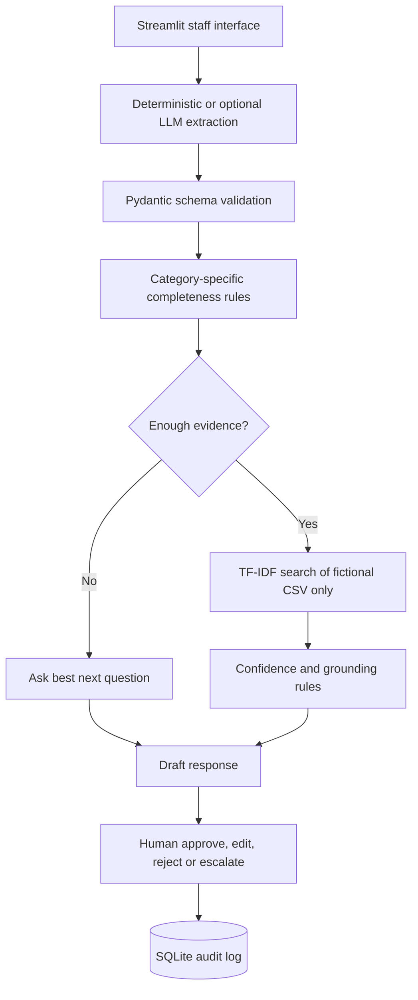

# Bathroom Spare Parts AI Enquiry Triage Assistant

A focused Streamlit prototype that turns a fictional customer enquiry into structured data, detects missing evidence, searches a small fictional catalogue, proposes up to three possible matches and prepares a draft response for staff approval.

The application is deliberately decision support, not automation of customer contact. Every outcome remains subject to human review.

## What is included

- Free-text enquiry intake and optional sample image upload
- Pydantic validated structured extraction
- Seven enquiry classes and nine product categories
- Category-specific completeness scoring and follow-up questions
- TF-IDF retrieval against a 40-record fictional CSV catalogue
- Confidence thresholds, evidence explanations and low-confidence escalation
- Editable customer response draft
- Approve, edit, reject and escalate workflow
- SQLite audit log with common email and phone patterns redacted
- Five fictional demonstration scenarios
- Deterministic offline mode plus optional OpenAI-assisted extraction
- Automated tests for extraction, retrieval safeguards and audit redaction

## Architecture



## Quick start

### Windows PowerShell

Python 3.11 or newer is recommended.

```powershell
py -3 -m venv .venv
.\.venv\Scripts\Activate.ps1
python -m pip install --upgrade pip
python -m pip install -r requirements.txt
streamlit run app.py
```

### macOS or Linux

```bash
python3 -m venv .venv
source .venv/bin/activate
python -m pip install --upgrade pip
python -m pip install -r requirements.txt
streamlit run app.py
```

Open the local URL shown by Streamlit, normally `http://localhost:8501`.

## Run the tests

```powershell
python -m pytest
```

## Three-minute demonstration

The ready-to-read walkthrough is in [DEMO.md](DEMO.md). A strong sequence is:

1. Load the complete shower-valve example to show extraction, evidence and a confident candidate.
2. Open the validated JSON and the editable draft.
3. Save an approval decision, then show the audit record.
4. Load the vague example to show that the app refuses to guess and escalates instead.

## Project structure

```text
app.py                         Streamlit interface and approval workflow
data/sample_catalogue.csv      40 fictional catalogue records
data/demo_enquiries.json       Five fictional demonstration scenarios
src/models.py                  Validated schema and enums
src/extraction.py              Classification, extraction and completeness rules
src/retrieval.py               Grounded TF-IDF catalogue retrieval
src/responses.py               Draft response generation
src/audit.py                   SQLite decision log
src/privacy.py                 Basic contact-detail redaction
src/llm.py                     Optional grounded OpenAI extraction
tests/                         Automated safeguards and behaviour tests
```

## Safeguards and limitations

- Catalogue suggestions can only use rows in `data/sample_catalogue.csv`; product names and SKUs are never generated.
- No more than three candidates are displayed.
- A result below the evidence threshold is labelled **Human review required**.
- Candidate wording is always “possible match”, never confirmed compatibility.
- Messages are drafted but never sent.
- The upload control records the presence of a photograph; the prototype does not perform image recognition or store the image in SQLite.
- This is not connected to live product, stock, order, customer or supplier systems.
- Basic redaction is not a substitute for a production data-loss-prevention service. Use fictional data only.
- Returns, warranty and installation questions remain policy or specialist decisions for staff.

The workflow was informed by the public [contact and part-identification guidance](https://www.bathroomspareparts.co.uk/contact-us-39-w.asp), [FAQ](https://www.bathroomspareparts.co.uk/faq-37-w.asp) and [returns policy](https://www.bathroomspareparts.co.uk/returns-policy-31-w.asp). The application does not scrape these pages at runtime.

## Deployment

### Streamlit Community Cloud

1. Push the project to a private GitHub repository.
2. In Streamlit Community Cloud, create an app with `app.py` as the entry point.
3. Add `OPENAI_API_KEY` and `OPENAI_MODEL` in the platform secrets only if assisted extraction is required.
4. Do not rely on the local SQLite file for durable multi-user production logging; use a managed database before real deployment.

The deterministic mode requires no secrets and is the safest interview demonstration configuration.

### Other container or VM platforms

Install `requirements.txt` and run:

```bash
streamlit run app.py --server.address 0.0.0.0 --server.port "$PORT"
```

Mount persistent storage or replace SQLite with a managed database if audit records must survive restarts.

## Production improvements

With authorised internal access, the same workflow could add live product and stock data, order lookup, inbox ingestion, ticket creation, image-similarity retrieval, supplier data, staff-feedback learning and operational reporting. These should be added behind explicit permissions, data-retention rules and monitoring—not inferred from this prototype.

